<div align="center">


### Connect claim history, business rules, relationship analysis, retrieval, and ML risk scoring in **one investigation workspace.**

<br/>

## 🚀 LIVE DEMO &nbsp;·&nbsp; TRY IT NOW

<a href="https://claimflow-4ej1.onrender.com"></a>
&nbsp;
<a href="https://claimflow-7qvu.onrender.com"></a>
<br/><br/>
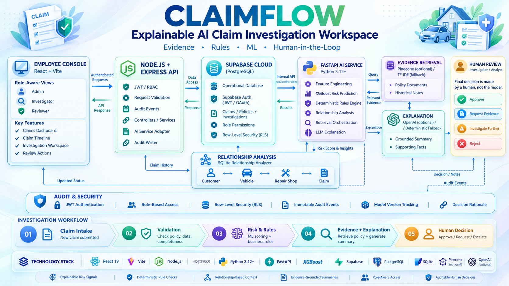
<br/><br/>

| 🌐 Service | 🔗 Link | 📦 Provides |
| :--- | :--- | :--- |
| **Node Backend** | [**claimflow-4ej1.onrender.com**](https://claimflow-4ej1.onrender.com) | Express API · auth · claims · investigations · analytics · audit logs |
| **AI Model Backend** | [**claimflow-7qvu.onrender.com**](https://claimflow-7qvu.onrender.com) | FastAPI inference + full claim-analysis API |
| **Swagger UI** | [**/docs**](https://claimflow-7qvu.onrender.com/docs) | Interactive OpenAPI documentation |
| **ReDoc** | [**/redoc**](https://claimflow-7qvu.onrender.com/redoc) | Alternative API documentation |
| **OpenAPI JSON** | [**/openapi.json**](https://claimflow-7qvu.onrender.com/openapi.json) | Machine-readable contract |

<br/>


</div>

<br/>

> [!IMPORTANT]
> **ClaimFlow is decision support, not autonomous adjudication.** It produces a model-generated investigation-risk estimate and an evidence summary. It does **not** determine fraud, guilt, liability, coverage, or claim eligibility. The final outcome belongs to a qualified human investigator.

---

## 📑 Table of Contents

<table>
<tr>
<td valign="top" width="33%">

**🧭 Overview**
- [What is ClaimFlow?](#-what-is-claimflow)
- [At a glance](#-at-a-glance)
- [Product capabilities](#-product-capabilities)
- [Tech stack](#-tech-stack)

**🏗️ Architecture**
- [System architecture](#️-system-architecture)
- [End-to-end flow](#-end-to-end-investigation-flow)
- [Repository structure](#-repository-structure)

</td>
<td valign="top" width="33%">

**💻 Application**
- [Frontend experience](#-frontend-experience)
- [Backend API](#-backend-api)
- [Authentication & RBAC](#-authentication-and-rbac)
- [Data model](#-data-model)

**🧠 Intelligence**
- [AI investigation engine](#-ai-investigation-engine)
- [ML model card](#-ml-model-card)
- [Synthetic data](#-synthetic-data-generation)
- [Retrieval & explanation](#-retrieval-and-explanation-layer)

</td>
<td valign="top" width="33%">

**⚙️ Operations**
- [Quick start](#-quick-start)
- [Environment variables](#-environment-variables)
- [Run the full stack](#-running-the-complete-stack)
- [Database setup](#-database-setup)
- [Data & model workflows](#-data-and-model-workflows)
- [API reference](#-api-reference)
- [Deployment](#-deployment)

**🛡️ Governance**
- [Testing & quality](#-testing-and-quality)
- [Security & privacy](#-security-and-privacy)
- [Limitations](#️-limitations-and-responsible-use)
- [Roadmap](#️-roadmap) · [Contributing](#-contributing) · [License](#-license)

</td>
</tr>
</table>

---

## 🔎 What is ClaimFlow?

ClaimFlow is an internal **claims-investigation platform** built around a simple operational problem: an investigator should not have to jump between a claims table, a policy document, a spreadsheet of historical activity, and a separate risk model just to understand *what deserves attention*.

The repository implements a staged full-stack system:

| Layer | Technology | Responsibility |
| :--- | :--- | :--- |
| 🖥️ **Frontend** | React + Vite | Investigator workspace |
| 🔌 **Backend** | Node.js + Express | Authentication, authorization, claims, investigations, analytics, audit logs, orchestration |
| 🤖 **AI service** | FastAPI | Model inference and full claim analysis |
| 🗄️ **Database** | Supabase / PostgreSQL | Operational persistence, employee accounts, assessments, signals, documents, audit logs |
| 🧪 **Data generator** | Python | Reproducible synthetic relational data for development and training |
| 📈 **ML pipeline** | XGBoost | Training with shared offline/online feature engineering |
| 📏 **Rules engine** | Python | Deterministic policy and claim checks |
| 🕸️ **Relationship analyzer** | SQL / SQLite | Customer, vehicle, repair-shop, and historical investigation context |
| 📚 **RAG layer** | Pinecone + OpenAI → TF-IDF fallback | Policy and investigator-note retrieval |
| 💬 **LLM explanation** | OpenAI → deterministic fallback | Factual, constrained investigation summaries |

---

## ✨ At a Glance

<div align="center">

| 📊 30,000 | 🧩 10 | 🎯 0.8031 | 🔐 3 | ⚖️ 100% |
| :---: | :---: | :---: | :---: | :---: |
| synthetic claims<br/>in training set | model features<br/>shared train ↔ serve | ROC AUC<br/>`claim-risk-v1` | roles<br/>Admin · Investigator · Reviewer | human final<br/>decision |

</div>

---

## 🧰 Product Capabilities

<details open>
<summary><b>👩‍💼 Investigator workspace</b></summary>

<br/>

- 🔑 Employee-only login through Supabase Auth.
- 🧭 Role-aware navigation and route protection.
- 📊 Dashboard with claim volume, flagged claims, high-risk claims, pending investigations, and reviewed-today metrics.
- 🔍 Searchable and paginated claims list.
- 🎛️ Filters for claim type, claim status, and investigation status.
- 📁 Claim detail workspace with customer, policy, vehicle, repair-shop, amount, dates, and description context.
- ▶️ On-demand **Run AI Investigation** action, so opening a claim never auto-incurs model or LLM work.
- 🌡️ Risk gauge and risk-band badge.
- ✅ Rule results with `PASS`, `WARN`, and `FAIL` states.
- 🕸️ Relationship context and related-claim mini-cards.
- 📚 Retrieved policy evidence and investigator notes.
- 📝 AI-generated or deterministic investigation summary.
- 🧑‍⚖️ Human decision panel: `APPROVE`, `REQUEST_DOCUMENTS`, `INVESTIGATE_FURTHER`, `REJECT`.
- 🕒 Investigation history timeline.
- 👥 Admin-only employee management.
- 📜 Admin-only audit-log browsing.

</details>

<details open>
<summary><b>🔌 Backend capabilities</b></summary>

<br/>

- Supabase Auth token validation.
- Employee-profile lookup and role enforcement.
- Zod request validation for body and query parameters.
- Helmet security headers, CORS, JSON parsing, and request logging.
- Claims CRUD paths used by the frontend.
- Server-to-server AI service adapter with configurable timeout.
- Persistence of ML assessments and structured risk signals.
- Automatic creation of open investigations for medium/high model results.
- Graceful degradation when AI analysis fails.
- Paginated claims, investigations, and audit-log queries.
- Dashboard and time-series analytics.

</details>

<details open>
<summary><b>🧠 ML and evidence capabilities</b></summary>

<br/>

- XGBoost binary classifier with Gradient Boosting fallback.
- Ten-feature prediction contract shared between training and inference.
- Risk thresholds loaded from model metadata.
- Causal historical features generated only from events **before** the current claim.
- Deterministic policy / coverage / document rules.
- SQL relationship analysis against a local SQLite mirror.
- Policy and investigator-note retrieval.
- Pinecone semantic retrieval when configured.
- Local TF-IDF retrieval fallback for credential-free development.
- OpenAI summary generation with factuality and terminology constraints.
- Deterministic summary fallback when the LLM is unavailable.

</details>

---

## 🧱 Tech Stack

| Area | Technologies |
| :--- | :--- |
| **Frontend** | React 19 · Vite · React Router · Axios · Recharts · Lucide icons |
| **Backend** | Node.js 20+ · Express · Zod · Helmet · Morgan · Vitest · Supertest |
| **AI service** | Python 3.12 · FastAPI · Pydantic · XGBoost · scikit-learn · SQLite |
| **Data / Auth** | Supabase Auth · PostgreSQL · Row Level Security |
| **Retrieval / LLM** | Pinecone · OpenAI embeddings · `gpt-4o-mini` · TF-IDF fallback |
| **Hosting** | Render (Node + FastAPI) · static frontend deployment |

---

## 🏗️ System Architecture

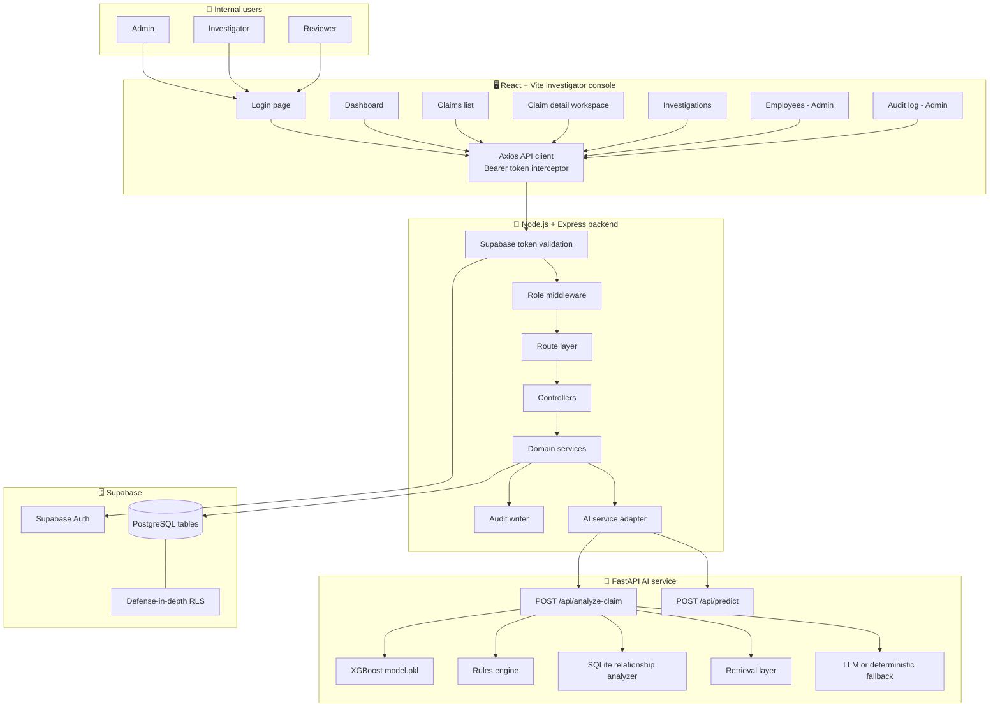

### 🧭 Architectural Boundaries

| Boundary | ✅ Owns | ❌ Deliberately does not own |
| :--- | :--- | :--- |
| **React frontend** | Navigation, forms, charts, role-aware presentation, user interaction | Database credentials, model logic, final decision policy |
| **Node backend** | Product API, auth verification, RBAC, persistence, orchestration, audit events | Model training and evidence generation internals |
| **AI service** | Prediction, rule evaluation, relationships, retrieval, summary generation | Employee identity, authorization, final human outcome |
| **Supabase** | Auth identities and operational records | Browser-side privileged writes |
| **Investigator** | Evidence review and final business decision | The internal mechanics of model training |

---

## 🔄 End-to-End Investigation Flow

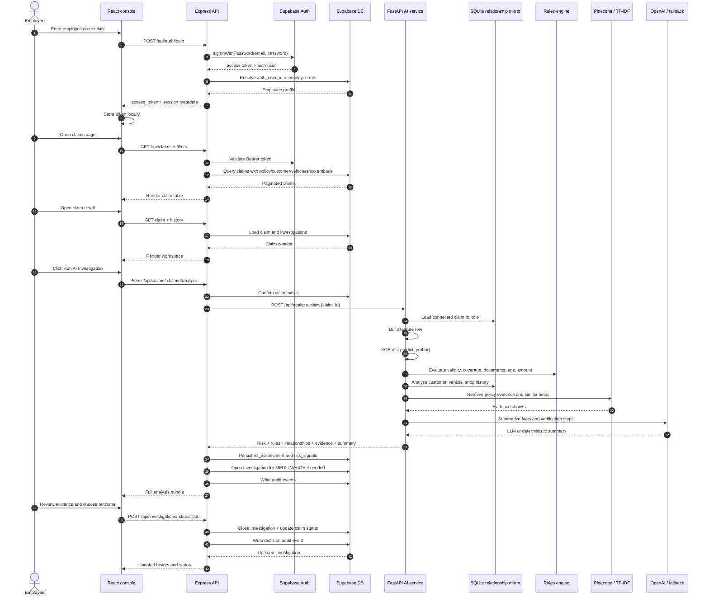

### ⚡ Analysis Pipeline

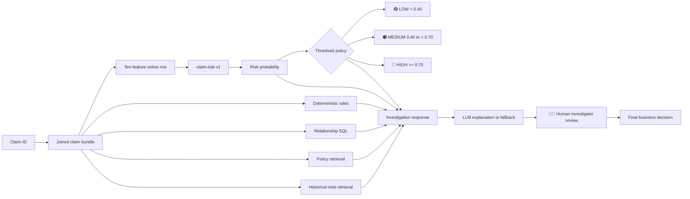

---

## 📂 Repository Structure

```
ClaimFlow/
├── README.md
├── pyproject.toml
├── requirements.txt
├── main.py
├── .python-version
├── database/
│   ├── schema.sql                  # Supabase/PostgreSQL schema
│   └── rls_policies.sql            # Row-level security policies
│
├── frontend/                       # React 19 + Vite investigator console
│   ├── package.json
│   ├── vite.config.js
│   ├── index.html
│   ├── .env.example
│   ├── public/
│   └── src/
│       ├── api/client.js           # Axios client + auth interceptors
│       ├── context/AuthContext.jsx
│       ├── components/
│       │   ├── Layout.jsx
│       │   ├── Sidebar.jsx
│       │   ├── Guards.jsx
│       │   ├── RiskBadge.jsx
│       │   ├── RiskGauge.jsx
│       │   ├── StatusBadge.jsx
│       │   ├── MiniClaimCard.jsx
│       │   └── Common.jsx
│       ├── pages/
│       │   ├── LoginPage.jsx
│       │   ├── DashboardPage.jsx
│       │   ├── ClaimsListPage.jsx
│       │   ├── ClaimDetailPage.jsx
│       │   ├── InvestigationsPage.jsx
│       │   ├── EmployeesPage.jsx
│       │   └── AuditLogPage.jsx
│       └── styles/index.css
│
├── server/                         # Node.js + Express application API
│   ├── package.json
│   ├── .env.example
│   ├── src/
│   │   ├── app.js                  # Express app composition
│   │   ├── server.js               # HTTP entry point
│   │   ├── config/env.js           # Startup configuration validation
│   │   ├── database/supabase.js    # Auth and service-role clients
│   │   ├── routes/                 # HTTP route definitions
│   │   ├── controllers/            # Request/response orchestration
│   │   ├── services/               # Domain and persistence logic
│   │   ├── middleware/             # Auth, RBAC, validation, errors
│   │   ├── validation/schemas.js   # Zod schemas
│   │   └── utils/
│   └── scripts/
│       ├── seed_employees.js
│       └── seed_supabase_from_csv.js
│
└── flow-predict-ml/                # FastAPI + model + data platform
    ├── requirements.txt
    ├── README.md
    ├── app/
    │   ├── main.py                 # FastAPI app and lifecycle
    │   ├── db.py                   # SQLite claim-bundle access
    │   ├── api/
    │   │   ├── routes_prediction.py
    │   │   └── routes_investigation.py
    │   ├── schemas/
    │   │   ├── claim.py
    │   │   └── investigation.py
    │   ├── ml/
    │   │   ├── features.py         # Shared train/serve feature contract
    │   │   └── predict.py          # Model loading and inference
    │   ├── rules/engine.py         # Explainable deterministic checks
    │   ├── relationships/analyzer.py
    │   ├── rag/
    │   │   ├── documents.py
    │   │   ├── embeddings.py
    │   │   ├── pinecone_client.py
    │   │   └── retriever.py
    │   └── llm/
    │       ├── client.py
    │       ├── prompts.py
    │       └── investigator.py
    ├── data_generator/
    │   ├── config.py
    │   └── generate_data.py
    ├── training/
    │   ├── train_model.py
    │   └── evaluate_model.py
    ├── scripts/
    │   ├── build_local_db.py
    │   └── index_documents.py
    ├── knowledge_base/
    │   └── build_knowledge_base.py
    ├── data/
    └── models/
        ├── model.pkl
        └── model_metadata.json
```

---

## 🖥️ Frontend Experience

An internal enterprise-style dashboard built with **React 19, Vite, React Router, Axios, Recharts, and Lucide icons**. It uses a restrained navy/paper visual system with a consistent 🟢 green / 🟠 amber / 🔴 red risk vocabulary.

### 🗺️ Routes

| Route | Page | Access |
| :--- | :--- | :--- |
| `/login` | Employee login | Public entry point |
| `/` | Dashboard | Any authenticated employee |
| `/claims` | Searchable claims table | Any authenticated employee |
| `/claims/:claimId` | Claim investigation workspace | Any authenticated employee; analysis is role-restricted |
| `/investigations` | Investigation queue | Any authenticated employee; decisions are role-restricted |
| `/employees` | Employee list and creation modal | `ADMIN` only |
| `/audit-log` | Filterable audit log | `ADMIN` only |

### 🧑‍💻 Claim Detail Workspace

The claim detail page is the **center of the product**. It loads the claim and history first, then waits for an explicit user action before calling the AI investigation route.

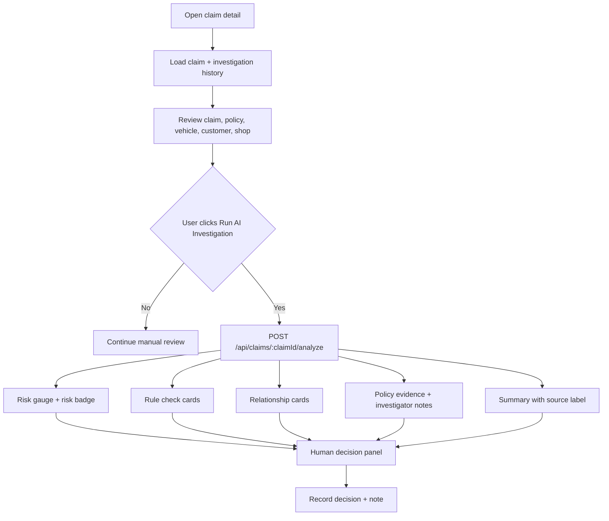

### 🧠 State and API Behavior

- `AuthContext` stores the employee session and exposes `login`, `logout`, `hasRole`, and `isAuthenticated`.
- `api/client.js` adds the stored `Bearer` token to every request.
- A `401` response clears the local session and redirects to `/login`.
- `RequireAuth` protects the authenticated application shell.
- `RequireRole` hides protected pages and renders a restricted-access state.
- Claims and investigation tables use **server-side** pagination and filters.
- Currency and dates are formatted for the `en-IN` locale.

---

## 🔌 Backend API

The Node service is mounted as a single Express application with security headers, CORS, JSON parsing, Morgan request logging, route modules, not-found handling, and centralized error handling.

### 📋 Route Inventory

| Method | Path | Auth | Role | Purpose |
| :---: | :--- | :---: | :---: | :--- |
| `GET` | `/` | ❌ | — | Service identity |
| `GET` | `/health` | ❌ | — | Node/AI dependency health |
| `POST` | `/api/auth/login` | ❌ | — | Supabase password login |
| `GET` | `/api/auth/me` | ✅ | Any | Return resolved employee profile |
| `GET` | `/api/claims` | ✅ | Any | Paginated, filtered claim list |
| `GET` | `/api/claims/:claimId` | ✅ | Any | Claim detail with embedded context |
| `GET` | `/api/claims/:claimId/history` | ✅ | Any | Investigation history for claim |
| `GET` | `/api/claims/:claimId/evidence` | ✅ | Any | Stored retrieved evidence |
| `GET` | `/api/claims/:claimId/relationships` | ✅ | Any | Stored relationship analysis |
| `POST` | `/api/claims` | ✅ | Admin, Investigator | Create a submitted claim |
| `POST` | `/api/claims/:claimId/analyze` | ✅ | Admin, Investigator | Run and persist full AI investigation |
| `GET` | `/api/investigations` | ✅ | Any | Paginated investigation queue |
| `POST` | `/api/investigations/:id/decision` | ✅ | Admin, Investigator | Record human decision and close investigation |
| `GET` | `/api/employees` | ✅ | Admin | List employee accounts |
| `POST` | `/api/employees` | ✅ | Admin | Create Auth user + employee profile |
| `GET` | `/api/analytics` | ✅ | Any | Risk distribution and claim time series |
| `GET` | `/api/dashboard` | ✅ | Any | Dashboard KPI bundle |
| `GET` | `/api/audit-logs` | ✅ | Admin | Paginated audit log |

<details>
<summary><b>🔍 Query parameters — claims & investigations</b></summary>

<br/>

**`GET /api/claims`**

| Parameter | Type | Default | Description |
| :--- | :--- | :--- | :--- |
| `status` | string | — | `SUBMITTED`, `UNDER_REVIEW`, `CLOSED` |
| `investigationStatus` | string | — | `NOT_FLAGGED`, `FLAGGED`, `INVESTIGATED` |
| `claimType` | string | — | `ACCIDENT`, `THEFT`, `FIRE`, `NATURAL_DISASTER`, `VANDALISM` |
| `search` | string | — | Searches claim ID, policy ID, or vehicle ID |
| `page` | integer | `1` | One-based page number |
| `pageSize` | integer | `20` | Range `1–100` |

**`GET /api/investigations`**

| Parameter | Type | Default | Description |
| :--- | :--- | :--- | :--- |
| `status` | string | — | `OPEN`, `IN_PROGRESS`, `CLOSED` |
| `priority` | string | — | `LOW`, `MEDIUM`, `HIGH` |
| `assignedTo` | string | — | Employee email |
| `page` | integer | `1` | One-based page number |
| `pageSize` | integer | `20` | Range `1–100` |

</details>

---

## 🔐 Authentication and RBAC

ClaimFlow uses **two Supabase clients** on the server for two different purposes:

1. **Auth client** — uses `SUPABASE_ANON_KEY` to validate access tokens and perform password login.
2. **Admin database client** — uses `SUPABASE_SERVICE_ROLE_KEY` for server-side reads and writes *after* the request has passed authentication and role middleware.

> [!WARNING]
> The service-role key must **never** be shipped to the browser.

### 🚦 Request Authorization Pipeline

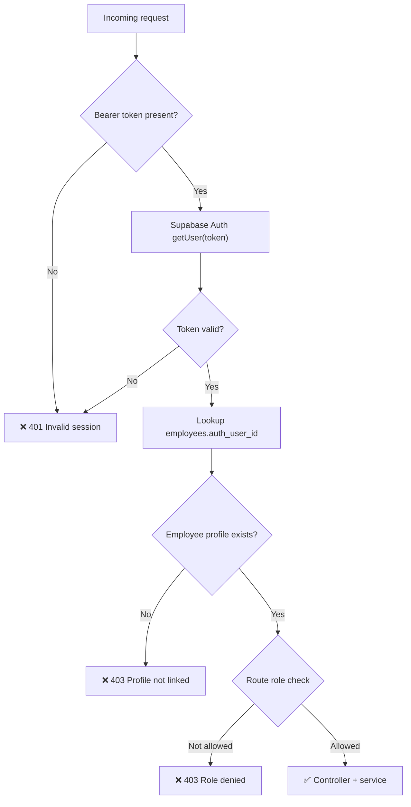

### 🛂 Role Matrix

| Capability | `ADMIN` | `INVESTIGATOR` | `REVIEWER` |
| :--- | :---: | :---: | :---: |
| Sign in | ✅ | ✅ | ✅ |
| View dashboard | ✅ | ✅ | ✅ |
| View claims | ✅ | ✅ | ✅ |
| View investigations | ✅ | ✅ | ✅ |
| Run AI investigation | ✅ | ✅ | ❌ |
| Create claim | ✅ | ✅ | ❌ |
| Record final investigation decision | ✅ | ✅ | ❌ |
| List employees | ✅ | ❌ | ❌ |
| Create employee | ✅ | ❌ | ❌ |
| Read audit logs | ✅ | ❌ | ❌ |

### 🧪 Demo Employee Seed Accounts

`server/scripts/seed_employees.js` creates accounts for local/demo environments:

| Role | Email | Password |
| :--- | :--- | :--- |
| 👑 Admin | `admin@claimflow.demo` | `ClaimFlow!Admin1` |
| 🕵️ Investigator | `investigator@claimflow.demo` | `ClaimFlow!Invest1` |
| 👀 Reviewer | `reviewer@claimflow.demo` | `ClaimFlow!Review1` |

> [!CAUTION]
> Do not use these credentials in a real deployment. Change or remove seeded users before production use.

---

## 🗃️ Data Model

The relational model connects customers, vehicles, policies, claims, repair shops, investigations, model assessments, risk signals, documents, employees, and audit records.

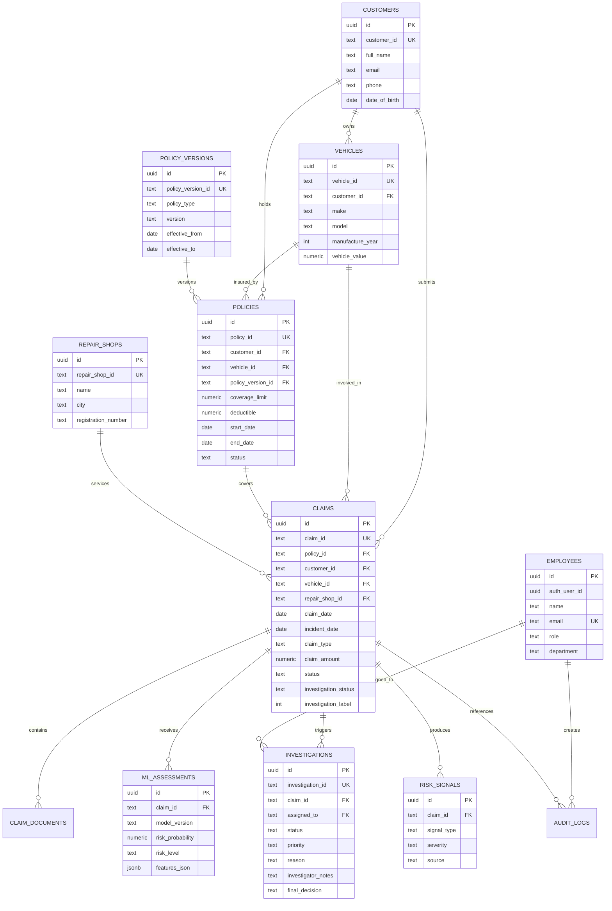

### 🔁 Claim Lifecycle

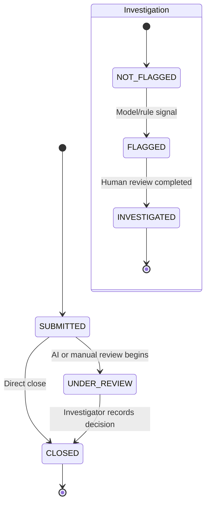

### 💾 Stored ML Output

When a claim is analyzed, the Node service stores the complete AI response in `ml_assessments.features_json`. Evidence and relationship views can then read the latest persisted result **without re-running the AI or LLM pipeline**.

Structured `risk_signals` are also created from:

- failed or warned rules;
- `MEDIUM` or `HIGH` model outputs;
- repair-shop history with prior investigations.

---

## 🧠 AI Investigation Engine

The full `/api/analyze-claim` workflow is deliberately composed of **separate components**, so investigators can distinguish statistical output from deterministic checks and retrieved context.

### 1️⃣ Claim bundle loading

`flow-predict-ml/app/db.py` joins the claim with:

- policy and policy version;
- customer;
- vehicle;
- repair shop;
- historical feature columns;
- claim and investigation status.

Local development uses `flow-predict-ml/data/claimflow.db`, a SQLite mirror built from generated CSVs. The schema is intentionally aligned with the Supabase/PostgreSQL model.

### 2️⃣ Model inference

The service builds the same ordered **ten-feature vector** used during training:

| # | Feature | # | Feature |
| :---: | :--- | :---: | :--- |
| 1 | `claim_amount` | 6 | `customer_claim_frequency` |
| 2 | `policy_age_days` | 7 | `repair_shop_claim_count_prior` |
| 3 | `vehicle_age` | 8 | `repair_shop_investigation_rate_prior` |
| 4 | `previous_claim_count` | 9 | `claim_amount_vs_vehicle_value` |
| 5 | `days_since_previous_claim` | 10 | `claim_amount_vs_customer_average` |

The model is loaded once during FastAPI startup. Its model version and thresholds are read from `models/model_metadata.json`.

### 3️⃣ Deterministic rules

The rules engine returns structured objects with `rule`, `status`, `severity`, and `message`.

| Rule | Behavior |
| :--- | :--- |
| `POLICY_VALIDITY` | 🔴 Fails when incident date is outside policy period |
| `COVERAGE_LIMIT` | 🔴 Fails when claim amount exceeds coverage limit |
| `REQUIRED_DOCUMENTS` | 🟠 Warns when expected claim documents are absent |
| `EARLY_POLICY` | 🟠 Warns when policy age is below 30 days |
| `HIGH_CLAIM_AMOUNT` | 🟠 Warns when claim amount exceeds 55% of vehicle value |

### 4️⃣ Relationship analysis

The relationship analyzer uses SQL queries against **actual connected records**, not generated narrative assumptions. It returns:

- repair-shop total and investigated claim counts;
- recent claims associated with the repair shop;
- vehicle claim history;
- customer claim history;
- historical investigation outcomes for the repair shop.

### 5️⃣ Evidence retrieval

The investigation pipeline queries two evidence families:

- 📘 policy documents filtered by policy type;
- 🗒️ historical investigator notes for similar investigation context.

The retriever prefers **Pinecone with OpenAI embeddings** when configured. Otherwise it loads a **local TF-IDF index** generated by `scripts/index_documents.py`.

### 6️⃣ Summary generation

When `OPENAI_API_KEY` is configured, the service uses `OPENAI_MODEL` (default `gpt-4o-mini`) to produce a concise factual summary. The prompt explicitly instructs the model to:

- use only supplied facts;
- preserve model/rule outputs;
- avoid fraud accusations;
- distinguish `PASS`, `WARN`, and `FAIL`;
- treat retrieved notes as historical examples rather than current-claim evidence;
- recommend verification steps without making the final decision.

If the LLM is unavailable, `deterministic_fallback` produces a rule- and relationship-based summary instead.

---

## 📈 ML Model Card

### 🏷️ Current Committed Artifact

| Property | Value |
| :--- | :--- |
| Model version | `claim-risk-v1` |
| Algorithm | XGBoost classifier |
| Fallback algorithm | `GradientBoostingClassifier` |
| Training rows | `30,000` |
| Positive label rate | `15.33%` |
| Random state | `42` |
| **ROC AUC** | **`0.8031`** |
| **PR AUC** | **`0.4572`** |
| 🟢 Low-risk upper bound | `< 0.40` |
| 🟠 Medium-risk range | `0.40` to `< 0.70` |
| 🔴 High-risk lower bound | `>= 0.70` |
| Artifact | `flow-predict-ml/models/model.pkl` |
| Metadata | `flow-predict-ml/models/model_metadata.json` |

### 📊 Feature Importance

| Feature | Importance | Visual |
| :--- | :---: | :--- |
| `customer_claim_frequency` | `0.3499` | ██████████████████░░ |
| `previous_claim_count` | `0.1969` | ██████████░░░░░░░░░░ |
| `days_since_previous_claim` | `0.0917` | █████░░░░░░░░░░░░░░░ |
| `claim_amount_vs_vehicle_value` | `0.0843` | ████░░░░░░░░░░░░░░░░ |
| `repair_shop_investigation_rate_prior` | `0.0809` | ████░░░░░░░░░░░░░░░░ |
| `policy_age_days` | `0.0463` | ██░░░░░░░░░░░░░░░░░░ |
| `repair_shop_claim_count_prior` | `0.0430` | ██░░░░░░░░░░░░░░░░░░ |
| `claim_amount` | `0.0364` | ██░░░░░░░░░░░░░░░░░░ |
| `claim_amount_vs_customer_average` | `0.0353` | ██░░░░░░░░░░░░░░░░░░ |
| `vehicle_age` | `0.0351` | ██░░░░░░░░░░░░░░░░░░ |

> [!NOTE]
> These values describe the committed **synthetic-data** experiment. They are not evidence of feature causality or production performance.

### 🎚️ Model Decision Boundary

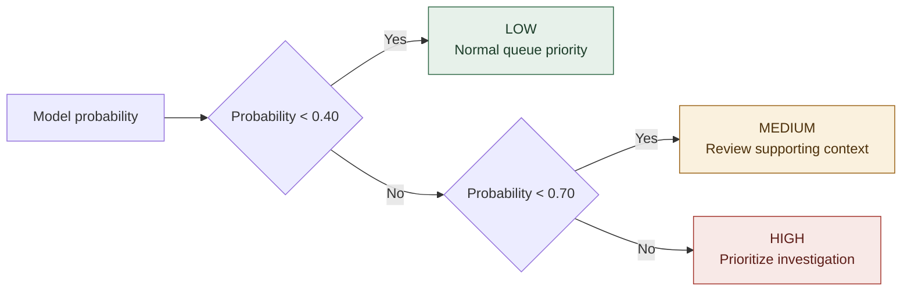

---

## 🧬 Synthetic Data Generation

The generator creates a **connected synthetic insurance ecosystem** rather than independent random rows.

### 📦 Default Volumes

| Entity | Default rows |
| :--- | ---: |
| Customers | `10,000` |
| Vehicles | `15,000` |
| Repair shops | `500` |
| Policies | `12,000` |
| Claims | `30,000` |
| Investigations | `4,598` *(committed generation summary)* |

### ⏳ Causal Feature Construction

For each claim, historical features are calculated **only from claims that occurred earlier in time**. This avoids using future information when computing:

- previous claim count;
- days since previous claim;
- customer claim frequency;
- prior average claim amount;
- prior repair-shop claim count;
- prior repair-shop investigation rate.

The synthetic `investigation_label` is produced from a weighted combination of signals plus noise. It represents a **historical pattern match for investigation — not a verified fraud label.**

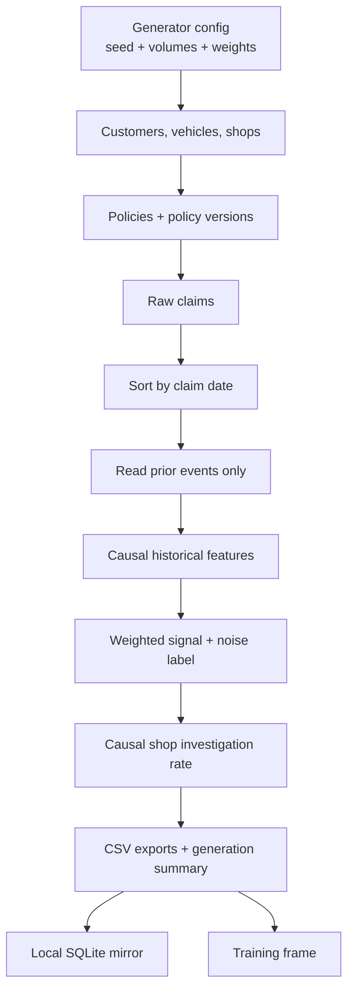

### 🎲 Reproducibility Controls

| Variable | Default | Purpose |
| :--- | :--- | :--- |
| `SEED` | `42` | Reproducible random seed |
| `NUM_CUSTOMERS` | `10000` | Customer count |
| `NUM_VEHICLES` | `15000` | Vehicle count |
| `NUM_REPAIR_SHOPS` | `500` | Repair-shop count |
| `NUM_POLICIES` | `12000` | Policy count |
| `NUM_CLAIMS` | `30000` | Claim count |
| `OUTPUT_DIR` | `data` | Generated output directory |

---

## 📚 Retrieval and Explanation Layer

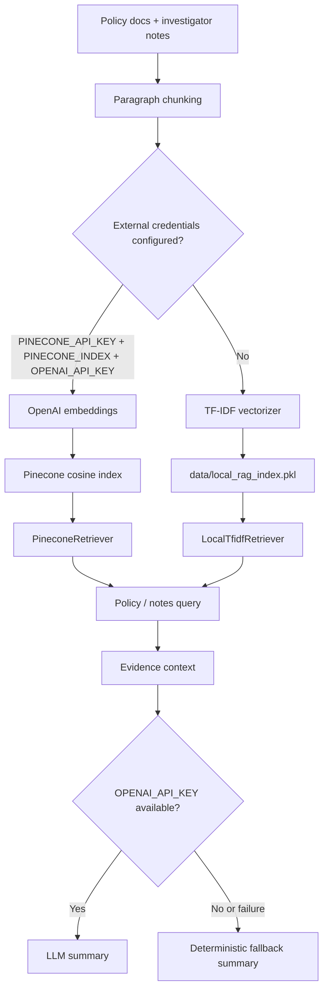

### 🏗️ Build the knowledge base

```bash
cd flow-predict-ml
python knowledge_base/build_knowledge_base.py
python scripts/index_documents.py
```

> [!TIP]
> If Pinecone and OpenAI credentials are not configured, indexing writes a local TF-IDF artifact and the analysis service continues without any external vector infrastructure.

---

## 🚀 Quick Start

### ✅ Prerequisites

- Git
- Node.js 20+ recommended, and npm
- Python 3.12 recommended (per the root `pyproject.toml`)
- A Supabase project for the Node backend
- *Optional:* OpenAI API key for generated summaries and embeddings
- *Optional:* Pinecone API key and index for semantic retrieval

### 📥 Clone the repository

```bash
git clone https://github.com/paras160500/ClaimFlow.git
cd ClaimFlow
```

<details open>
<summary><b>🖥️ 1 · Frontend</b></summary>

```bash
cd frontend
npm install
cp .env.example .env
npm run dev
```

The Vite dev server typically runs at `http://localhost:5173`.

</details>

<details open>
<summary><b>🔌 2 · Node backend</b></summary>

```bash
cd server
npm install
cp .env.example .env
```

Populate `.env` with your Supabase values, then start the API:

```bash
npm run dev
```

The Node API defaults to `http://localhost:4000`.

</details>

<details open>
<summary><b>🤖 3 · AI service</b></summary>

```bash
cd flow-predict-ml
python -m venv .venv
source .venv/bin/activate

# Windows PowerShell:
# .venv\Scripts\Activate.ps1

python -m pip install --upgrade pip
pip install -r requirements.txt
```

Start the FastAPI service:

```bash
uvicorn app.main:app --reload --host 0.0.0.0 --port 8000
```

| Resource | URL |
| :--- | :--- |
| Swagger UI | `http://localhost:8000/docs` |
| ReDoc | `http://localhost:8000/redoc` |
| Health | `http://localhost:8000/health` |

</details>

---

## 🔧 Environment Variables

<details>
<summary><b>🖥️ Frontend — <code>frontend/.env</code></b></summary>

```env
VITE_API_BASE_URL=http://localhost:4000
```

</details>

<details>
<summary><b>🔌 Node backend — <code>server/.env</code></b></summary>

```env
NODE_ENV=development
PORT=4000
SUPABASE_URL=https://YOUR_PROJECT.supabase.co
SUPABASE_ANON_KEY=your-anon-key
SUPABASE_SERVICE_ROLE_KEY=your-service-role-key
AI_SERVICE_URL=http://localhost:8000
AI_SERVICE_TIMEOUT_MS=20000
ALLOWED_ORIGINS=http://localhost:5173
LOG_LEVEL=dev
```

| Variable | Required | Description |
| :--- | :---: | :--- |
| `NODE_ENV` | No | Runtime environment; defaults to `development` |
| `PORT` | No | Express port; defaults to `4000` |
| `SUPABASE_URL` | **Yes** | Supabase project URL |
| `SUPABASE_ANON_KEY` | **Yes** | Used for auth login/token validation |
| `SUPABASE_SERVICE_ROLE_KEY` | **Yes** | Server-only privileged database client |
| `AI_SERVICE_URL` | No | AI service base URL; defaults to `http://localhost:8000` |
| `AI_SERVICE_TIMEOUT_MS` | No | Axios AI request timeout; defaults to `20000` |
| `ALLOWED_ORIGINS` | No | Comma-separated CORS origins |
| `LOG_LEVEL` | No | Morgan log format; defaults to `dev` |

</details>

<details>
<summary><b>🤖 AI service variables</b></summary>

| Variable | Default | Description |
| :--- | :--- | :--- |
| `DATA_DIR` | `../data` relative to app modules | CSV/SQLite data location |
| `MODEL_DIR` | `../models` relative to app modules | Model artifact location |
| `MODEL_VERSION` | `claim-risk-v1` | Metadata version label during training |
| `ALLOWED_ORIGINS` | `*` | FastAPI CORS origins |
| `LOG_LEVEL` | `INFO` | Python logging level |
| `OPENAI_API_KEY` | — | Enables LLM summaries and embeddings |
| `OPENAI_MODEL` | `gpt-4o-mini` | Summary-generation model |
| `OPENAI_EMBEDDING_MODEL` | `text-embedding-3-small` | Embedding model |
| `PINECONE_API_KEY` | — | Enables Pinecone retrieval |
| `PINECONE_INDEX` | — | Pinecone index name |
| `LOCAL_RAG_INDEX_PATH` | `data/local_rag_index.pkl` | Local TF-IDF index path |

</details>

> [!CAUTION]
> Never commit `.env` files, Supabase service-role keys, OpenAI keys, Pinecone keys, or production tokens.

---

## 🧩 Running the Complete Stack

Use **three terminals** from the repository root.

| Terminal | Service | Commands |
| :---: | :--- | :--- |
| **1** | 🤖 AI service | `cd flow-predict-ml && source .venv/bin/activate && uvicorn app.main:app --reload --port 8000` |
| **2** | 🔌 Node API | `cd server && npm run dev` |
| **3** | 🖥️ React frontend | `cd frontend && npm run dev` |

**Request path:**

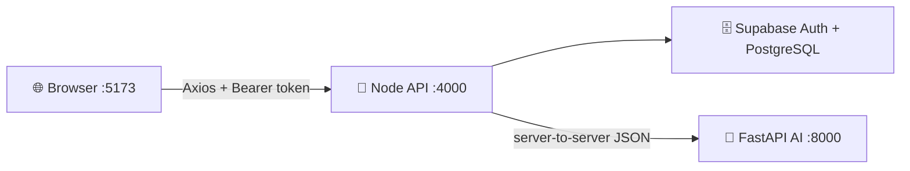

The Node backend should use the AI service URL configured in `AI_SERVICE_URL`. The frontend should use the Node URL configured in `VITE_API_BASE_URL`.

---

## 🗄️ Database Setup

### 1. Apply the schema

1. Create a Supabase project.
2. Open the Supabase SQL editor.
3. Run `database/schema.sql`.
4. Run `database/rls_policies.sql`.
5. Add the project URL and keys to `server/.env`.

The schema creates the core entities plus investigation, document, ML, risk-signal, employee, and audit tables.

### 2. Seed generated data

After generating the local CSVs, upload them into Supabase through the Node seed script:

```bash
cd server
npm run seed:data
```

The script reads from `flow-predict-ml/data/`. Override the directory with:

```bash
CSV_DATA_DIR=/absolute/path/to/data npm run seed:data
```

Parent records are inserted before child records, and batches are upserted with conflict keys.

### 3. Seed demo employees

```bash
cd server
npm run seed:employees
```

Creates Supabase Auth users and matching `employees` rows for the Admin, Investigator, and Reviewer demo accounts.

### 🛡️ RLS model

Row Level Security is enabled as **defense in depth**. The Node application uses the service-role client for its own authorized server-side queries, while `requireAuth` and `requireRole` enforce API access. Direct public/anon access remains restricted by RLS policies.

---

## 🛠️ Data and Model Workflows

### 🧪 Generate data

```bash
cd flow-predict-ml
source .venv/bin/activate
python data_generator/generate_data.py
```

**Fast experiment:**

```bash
SEED=7 \
NUM_CUSTOMERS=2500 \
NUM_VEHICLES=4000 \
NUM_POLICIES=3000 \
NUM_CLAIMS=8000 \
python data_generator/generate_data.py
```

### 🗃️ Build the local SQLite mirror

```bash
python scripts/build_local_db.py
```

Creates `flow-predict-ml/data/claimflow.db`.

### 🎓 Train the model

```bash
python training/train_model.py
```

The training script:

1. Loads `claims.csv` and `vehicles.csv`.
2. Builds the shared training frame.
3. Performs a stratified 80/20 train/test split with `random_state=42`.
4. Trains XGBoost with class-imbalance weighting.
5. Falls back to scikit-learn Gradient Boosting if XGBoost cannot be imported.
6. Computes ROC AUC, PR AUC, and a classification report.
7. Saves `model.pkl` and `model_metadata.json`.

### 📏 Evaluate the model

```bash
python training/evaluate_model.py
```

### 📚 Build the evidence index

```bash
python knowledge_base/build_knowledge_base.py
python scripts/index_documents.py
```

### ♻️ Recommended reproducible pipeline

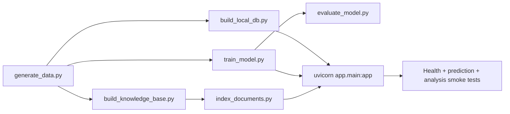

---

## 📖 API Reference

The AI service has a complete OpenAPI contract at [`/openapi.json`](https://claimflow-7qvu.onrender.com/openapi.json) and interactive docs at [**Swagger UI**](https://claimflow-7qvu.onrender.com/docs). The most important endpoints are documented below.

<details>
<summary><b><code>POST</code> /api/auth/login</b></summary>

```bash
curl -X POST http://localhost:4000/api/auth/login \
  -H 'Content-Type: application/json' \
  -d '{
    "email": "investigator@claimflow.demo",
    "password": "ClaimFlow!Invest1"
  }'
```

Returns an access token and session expiry metadata.

</details>

<details>
<summary><b><code>GET</code> /api/claims</b></summary>

```bash
curl 'http://localhost:4000/api/claims?page=1&pageSize=20&investigationStatus=FLAGGED' \
  -H "Authorization: Bearer $CLAIMFLOW_TOKEN"
```

Response shape:

```json
{
  "claims": [],
  "total": 0,
  "page": 1,
  "pageSize": 20
}
```

</details>

<details>
<summary><b><code>GET</code> /api/claims/:claimId</b></summary>

Returns a claim with embedded policy, customer, vehicle, and repair-shop context.

</details>

<details open>
<summary><b>⭐ <code>POST</code> /api/claims/:claimId/analyze — primary product workflow</b></summary>

```bash
curl -X POST http://localhost:4000/api/claims/CL050001/analyze \
  -H "Authorization: Bearer $CLAIMFLOW_TOKEN"
```

Successful response shape:

```json
{
  "claim": {},
  "ai": {
    "claim_id": "CL050001",
    "risk_probability": 0.8124,
    "risk_level": "HIGH",
    "model_version": "claim-risk-v1",
    "rule_results": [],
    "relationships": {},
    "retrieved_policy_evidence": [],
    "retrieved_investigator_notes": [],
    "summary": "...",
    "summary_source": "llm",
    "disclaimer": "This is a model-generated risk/investigation-probability estimate and an AI-generated summary of retrieved evidence -- not a determination of fraud. The final decision belongs to a human investigator."
  },
  "investigation": {}
}
```

> [!NOTE]
> If the AI service is temporarily unavailable, the Node route returns the claim with `ai: null` and a user-safe `ai_error`, while writing an `AI_INVESTIGATION_FAILED` audit event.

</details>

<details>
<summary><b><code>POST</code> /api/predict (AI service) — direct model-only prediction</b></summary>

```bash
curl -X POST https://claimflow-7qvu.onrender.com/api/predict \
  -H 'Content-Type: application/json' \
  -d '{
    "claim_id": "CL050001",
    "claim_amount": 133300,
    "policy_age_days": 18,
    "vehicle_age": 4,
    "previous_claim_count": 4,
    "days_since_previous_claim": 4,
    "customer_claim_frequency": 6,
    "repair_shop_claim_count_prior": 100,
    "repair_shop_investigation_rate_prior": 0.135,
    "vehicle_value": 393000,
    "customer_avg_claim_amount_prior": 207033.33
  }'
```

Response:

```json
{
  "claim_id": "CL050001",
  "risk_probability": 0.8124,
  "risk_level": "HIGH",
  "model_version": "claim-risk-v1",
  "disclaimer": "This is a model-generated risk/investigation-probability estimate, not a determination of fraud. The final decision belongs to a human investigator."
}
```

**Direct prediction input contract**

| Field | Type | Required | Validation / behavior |
| :--- | :--- | :---: | :--- |
| `claim_id` | string or null | No | Echoed into response |
| `claim_amount` | number | **Yes** | Must be `>= 0` |
| `policy_age_days` | number | **Yes** | Days from policy start to claim |
| `vehicle_age` | number or null | No | Defaults to `5` in feature construction |
| `previous_claim_count` | number or null | No | Defaults to `0` |
| `days_since_previous_claim` | number or null | No | Defaults to `-1` for no previous claim |
| `customer_claim_frequency` | number or null | No | Defaults to `0` |
| `repair_shop_claim_count_prior` | number or null | No | Defaults to `0` |
| `repair_shop_investigation_rate_prior` | number or null | No | Range `0–1`, defaults to `0` |
| `vehicle_value` | number or null | No | Positive when supplied; used for ratio |
| `customer_avg_claim_amount_prior` | number or null | No | Positive when supplied; used for ratio |

</details>

<details>
<summary><b><code>POST</code> /api/analyze-claim (AI service)</b></summary>

```bash
curl -X POST https://claimflow-7qvu.onrender.com/api/analyze-claim \
  -H 'Content-Type: application/json' \
  -d '{"claim_id":"CL050001"}'
```

</details>

<details>
<summary><b><code>POST</code> /api/investigations/:id/decision</b></summary>

```bash
curl -X POST http://localhost:4000/api/investigations/INV-CL050001-123456789/decision \
  -H "Authorization: Bearer $CLAIMFLOW_TOKEN" \
  -H 'Content-Type: application/json' \
  -d '{
    "decision": "REQUEST_DOCUMENTS",
    "note": "Please obtain the independent repair estimate and incident evidence."
  }'
```

**Allowed decisions:** `APPROVE` · `REQUEST_DOCUMENTS` · `INVESTIGATE_FURTHER` · `REJECT`

The service writes the decision into the investigation, closes it, updates the related claim to `INVESTIGATED` / `CLOSED`, and records an audit entry.

</details>

### 🚨 Error Behavior

| Status | Meaning |
| :---: | :--- |
| `200` | Successful response |
| `401` | Missing or invalid Node Bearer token |
| `403` | Employee profile or role restriction |
| `404` | Claim or investigation not found |
| `422` | FastAPI validation failure for AI input |
| `503` | AI model unavailable for direct prediction |
| `500` | Unexpected server-side failure |

### 🩺 Service Identity Responses

<details>
<summary><b>Show root &amp; health payloads</b></summary>

**Node API root**

```json
{
  "service": "ClaimFlow API",
  "stage": 3,
  "status": "ok"
}
```

**AI service root**

```json
{
  "service": "ClaimFlow AI Service",
  "stage": 1,
  "status": "ok",
  "model_loaded": true
}
```

**AI service health**

```json
{
  "status": "healthy",
  "model_loaded": true,
  "model_version": "claim-risk-v1"
}
```

</details>

---

## ☁️ Deployment

### 🧭 Render Service Topology

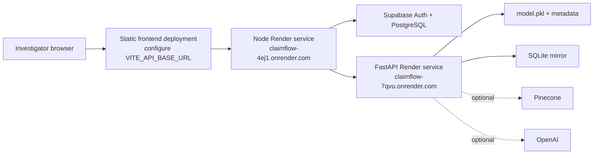

<details>
<summary><b>🔌 Node service deployment</b></summary>

Set the Render service working directory to `server` or configure the equivalent build/start commands:

```bash
npm install
npm start
```

Required environment variables:

- `SUPABASE_URL`
- `SUPABASE_ANON_KEY`
- `SUPABASE_SERVICE_ROLE_KEY`
- `AI_SERVICE_URL`
- `ALLOWED_ORIGINS`
- `PORT` *(when supplied by the platform)*

</details>

<details>
<summary><b>🤖 AI service deployment</b></summary>

Set the Render service working directory to `flow-predict-ml` and use:

```bash
pip install -r requirements.txt
uvicorn app.main:app --host 0.0.0.0 --port $PORT
```

Make sure the service includes:

- `models/model.pkl`
- `models/model_metadata.json`
- the SQLite database, or a build step that creates it
- knowledge-base/index artifacts if full analysis is enabled

The FastAPI lifespan loads the model at startup. If the model is absent, the service can start in a degraded state for health visibility, but prediction is unavailable until the artifact exists.

</details>

<details>
<summary><b>🖥️ Frontend deployment</b></summary>

Build the React application:

```bash
cd frontend
npm run build
```

Deploy the generated `dist/` directory as a static site and set:

```env
VITE_API_BASE_URL=https://claimflow-4ej1.onrender.com
```

Use a history-fallback rewrite to `index.html` for React Router routes.

</details>

### 🏭 Production Hardening Before Real Deployment

- [ ] Replace wildcard CORS with exact origins.
- [ ] Add service-to-service authentication between Node and FastAPI.
- [ ] Remove demo credentials and seed scripts from production workflows.
- [ ] Use secret-manager-backed environment variables.
- [ ] Add rate limiting and request-size limits.
- [ ] Add centralized structured logs and correlation IDs.
- [ ] Restrict access to AI service endpoints if they are not intended to be public.
- [ ] Validate model artifact integrity and compatibility during deployment.

---

## ✅ Testing and Quality

| Area | Commands |
| :--- | :--- |
| 🖥️ **Frontend** | `cd frontend && npm run lint && npm run build && npm run preview` |
| 🔌 **Node backend** | `cd server && npm test` *(Vitest + Supertest)* |
| 🤖 **AI smoke checks** | `curl http://localhost:8000/health` · `curl http://localhost:8000/openapi.json` |

### 🔺 Recommended Test Pyramid

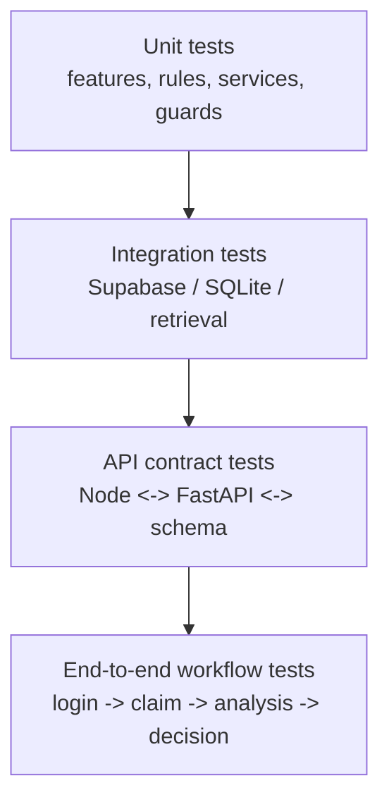

**Recommended coverage includes:**

- Zod request validation and FastAPI schema validation.
- Bearer-token and role middleware behavior.
- Claim filters, pagination, and embedded records.
- Model feature parity between training and inference.
- Threshold-to-risk-band mapping.
- Rules engine boundary cases.
- Relationship counts excluding the current claim.
- Pinecone-to-TF-IDF fallback behavior.
- LLM-to-deterministic-summary fallback behavior.
- AI timeout and degraded Node response behavior.
- Human decision persistence and audit logging.
- RLS policy behavior for direct Supabase access.

---

## 🛡️ Security and Privacy

Claim data can include sensitive personal, financial, vehicle, and incident information. Any production adaptation should treat security and governance as **core product behavior**.

<table>
<tr>
<td valign="top" width="50%">

### ✅ Implemented controls

- Supabase Auth for identity and token validation.
- Server-side role resolution through the `employees` table.
- Admin-only employee-management routes.
- Admin-only audit-log route.
- Helmet security headers.
- Configurable CORS.
- Zod validation for Node inputs.
- Pydantic validation for AI inputs.
- Service-role key isolated to the backend.
- RLS policies for direct Supabase defense in depth.
- Centralized error responses.
- Audit events for login, claim access, claim creation, AI analysis, AI failures, and decisions.

</td>
<td valign="top" width="50%">

### 🔒 Required hardening

- Use HTTPS everywhere.
- Restrict `ALLOWED_ORIGINS`.
- Protect or private-network the AI service.
- Add request rate limits and abuse detection.
- Avoid logging raw PII or document contents.
- Encrypt sensitive data at rest and in transit.
- Define claim-data retention and deletion policies.
- Add access reviews and credential rotation.
- Add model and prompt versioning to audit records.
- Add fairness and disparate-impact evaluation before real-world use.
- Provide appeal and investigator override workflows.

</td>
</tr>
</table>

---

## ⚖️ Limitations and Responsible Use

> [!WARNING]
> **A high score is not proof of wrongdoing.** It is a prioritization signal. The product keeps the final decision with the investigator and stores the human decision separately from the model output.

| Topic | What to know |
| :--- | :--- |
| 🧬 **Synthetic data** | The committed data and model are synthetic. Training labels represent generated investigation-pattern matches — **not** verified fraud outcomes or a real insurer's population. |
| 📉 **Performance interpretation** | ROC AUC and PR AUC demonstrate the pipeline but are **not** evidence of production performance. Real deployment requires representative validation, calibration analysis, threshold selection based on investigator capacity, monitoring, and governance. |
| 🧑‍⚖️ **Human decision requirement** | A model score never replaces review. The investigator owns the final business decision. |
| 💬 **Explainability boundary** | The summary layer explains computed and retrieved evidence. It must not invent facts, rewrite model outputs, turn warnings into failures, or make a final approve/reject decision. Historical investigator notes are context for verification, not proof that the current claim has the same facts. |

---

## 🗺️ Roadmap

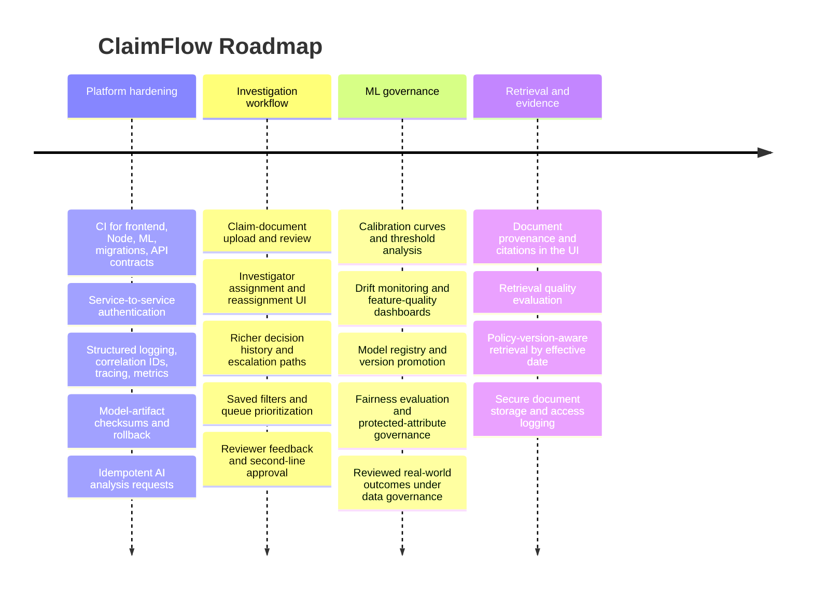

<details>
<summary><b>📋 Roadmap as a checklist</b></summary>

**🏗️ Platform hardening**

- [ ] Add automated CI for frontend, Node, ML, database migrations, and API contracts.
- [ ] Add service-to-service authentication.
- [ ] Add structured logging, correlation IDs, tracing, and metrics.
- [ ] Add model-artifact checksums and rollback support.
- [ ] Add idempotency controls for repeated AI analysis requests.

**🕵️ Investigation workflow**

- [ ] Add claim-document upload and review flows.
- [ ] Add investigator assignment and reassignment UI.
- [ ] Add richer decision history and escalation paths.
- [ ] Add saved filters and queue prioritization.
- [ ] Add reviewer feedback and second-line approval workflows.

**🧠 ML governance**

- [ ] Add calibration curves and threshold analysis.
- [ ] Add drift monitoring and feature-quality dashboards.
- [ ] Add model registry/version promotion.
- [ ] Add fairness evaluation and protected-attribute governance.
- [ ] Add real-world, reviewed outcomes only after appropriate data governance.

**📚 Retrieval and evidence**

- [ ] Add document provenance and citation display in the UI.
- [ ] Add retrieval quality evaluation.
- [ ] Add policy-version-aware retrieval by effective dates.
- [ ] Add secure document storage and access logging.

</details>

---

## 🤝 Contributing

1. **Fork** the repository.
2. Create a focused branch:
   ```bash
   git checkout -b feat/your-change
   ```
3. Keep the Node, FastAPI, database, and frontend contracts aligned.
4. Add or update tests for changed behavior.
5. If model behavior changes, regenerate `model_metadata.json` and document the experiment.
6. If API behavior changes, update the OpenAPI-facing examples and this README.
7. Do not include secrets, real personal information, or production claim documents.
8. Open a pull request describing the problem, implementation, tests, API/schema changes, model metrics, limitations, and security/privacy impact.

---

## 📄 License

No explicit repository license is currently declared. Add a license file and update this section before distributing ClaimFlow or accepting external contributions under a defined legal license.

---

## ⚠️ Disclaimer

ClaimFlow is an AI-assisted insurance claim investigation and prioritization platform. Its outputs are model-generated estimates and evidence summaries. They are **not** determinations of fraud, guilt, liability, coverage, or claim eligibility. The system must not be used as the sole basis for an adverse decision. A qualified human investigator must review the relevant claim facts, policy terms, supporting evidence, and applicable law.

<br/>

<div align="center">

<a href="https://claimflow-4ej1.onrender.com"></a>
<a href="https://claimflow-7qvu.onrender.com"></a>
<a href="https://claimflow-7qvu.onrender.com/docs"></a>
<a href="https://github.com/paras160500/ClaimFlow"></a>

<br/><br/>

**ClaimFlow — investigate with context, decide with accountability.**


</div>
